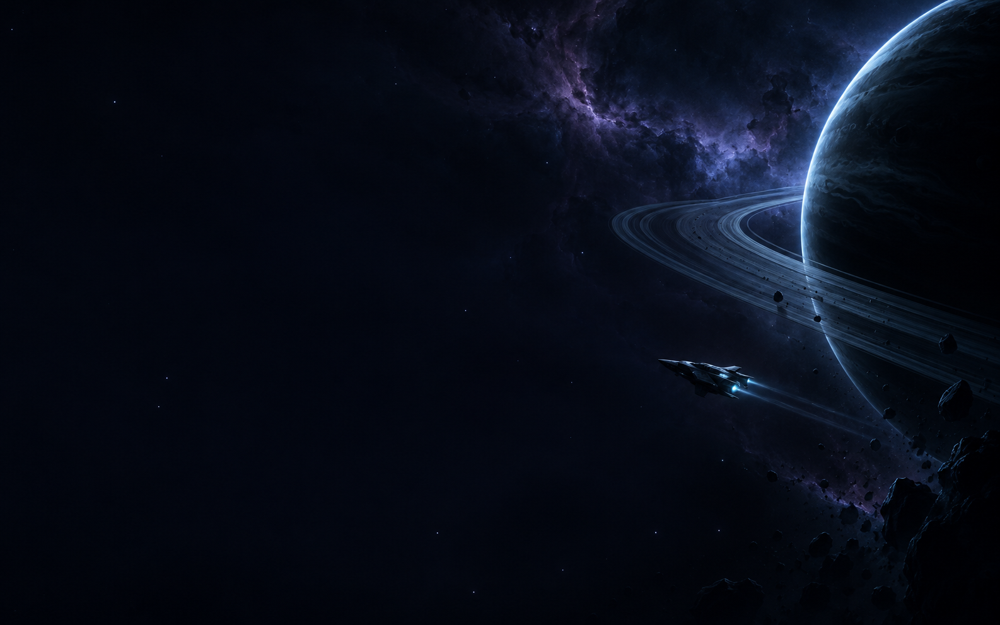

# ORBIT

A space-themed terminal setup for Kitty, Neovim, tmux, Starship, and Neofetch.
Midnight navy, cyan starlight, violet accents, a spacecraft backdrop, and a white
cursor trail. Includes the Mocha theme and a command to restore the setup that
was present before installation.



## Install

Built and tested on macOS. Requires Python 3.11+, Neovim 0.12+, a recent Kitty
with cursor-trail support, tmux, Starship, Git, ripgrep, a C compiler, and the
tree-sitter CLI. A Nerd Font is needed for icons; Departure Mono Nerd Font Mono
is the default. Font files and external editor plugins are not vendored.

Neofetch 7.1.0 is included with its MIT license. The custom macOS configuration
reports physical memory directly, avoiding its older VM-page-size assumption.

```sh
cp .config.example .config
# Edit .config to choose your alias, font, cursor, and other preferences.
python3 install.py --dry-run
python3 install.py
```

The installer appends a small source block to `.zshrc`, makes a local backup,
and writes both themes. It preserves the rest of your shell configuration.
Start a new Kitty shell and open Neovim. Neovim downloads plugins on first
launch; `:TSInstallDefaults` installs the configured parsers and `:Mason` manages
language servers.

The installer needs no Python packages beyond the standard library. It does not
install Homebrew packages or download fonts. Install those prerequisites with
your preferred package manager before running it.

## Personal settings

**Edit `.config` in this repository, then run `python3 install.py` to apply it.**
The real `.config` is ignored by Git. Only the generic `.config.example` is
committed. The installer validates values before changing files.

| Section | Settings |
| --- | --- |
| `identity` | Display alias and whether to show the hostname |
| `kitty` | Font, size, padding, wallpaper, tint |
| `cursor` | Color, trail trigger, decay, movement threshold |
| `tmux` | Prefix and status label |
| `editor` | Executable, leader, clipboard, language servers |
| `welcome` | Startup card and system fields |
| `paths` | Private tool directories to add to PATH |

The default alias is `pilot`; OS usernames and hostnames are hidden in the
rendered prompt and tmux bar. The Neofetch card uses the alias and hides the
machine identifier by default. CPU, OS, uptime, and memory remain runtime system
information, and can be removed from the card if desired. No command output or
machine snapshot is included in this repository.

An installed copy of your preferences is kept locally at
`~/.config/terminal-themes/personal.toml` with mode 0600. Backups, absolute-path
manifests, theme snapshots, shell history, credentials, and local preferences
stay outside the repo.

## Switch themes

```sh
swap terminal            # Toggle space ↔ your original configuration
swap terminal original   # Restore the pre-installation files
swap terminal space      # Space theme
swap terminal mocha      # Mocha theme
swap terminal status     # Current profile
neofetch                 # Show the spacecraft system card
```

Switches save changes made to the profile you leave. Kitty and an existing tmux
server reload automatically. Restart Neovim to load its theme. Re-running the
installer renders fresh themes from `.config` and preserves the original
snapshot; the active files are also backed up before each installation.

`swap terminal original` restores managed files, including removing generated
files that were originally absent. The shared switch command and shell loader
stay installed so you can switch back. Remove the ORBIT source block from
`.zshrc` and the installed helpers if you later want to uninstall completely.

## Editing

Neovim includes nvim-tree, Twilight dimming, UFO folding, Treesitter without
additional regex highlighting, multicursors, completion, LSP, fuzzy search,
Git signs, and formatting. Space is the default leader. Ctrl-N adds matching
cursors; Escape clears them. The default tmux prefix is Option-A.

[Keyboard guide](docs/KEYS.md)

## MRROBOT lab

An optional red-themed x86 Linux CTF environment runs behind `mrrobot`, with
Pwndbg/GDB, tracing tools, pwntools, a compiler toolchain, tmux, Neovim, and
Starship. Prepare it once while online; later sessions use the local image and
start offline. File transfers use `mrrobot push mac:/path ctf:/work/path` and
`mrrobot pull ctf:/work/path mac:/path`.

Sessions are temporary: pull your work before the last shell exits. The prepared
image stays local; session overlays and build downloads are removed. See the
[MRROBOT guide](mrrobot/README.md) for setup, tools, storage, and network options.

## Validation and privacy

```sh
python3 -m unittest discover -s tests -v
python3 scripts/check_privacy.py
git status --ignored --short
```

Tests install into a temporary home, check settings rendering and exact rollback,
and verify that local profile edits survive theme switches. The privacy scan
checks tracked and unignored files for user-home paths, common credentials,
private snapshots, and textual image metadata. Review your staged changes before
sharing any customization.

## Credits

The backdrop was created with imagegen for this setup. Neofetch is by Dylan
Araps; its original source and license are in `vendor/neofetch/`. Neovim plugins
are downloaded from their upstream projects and pinned in `lazy-lock.json`.
